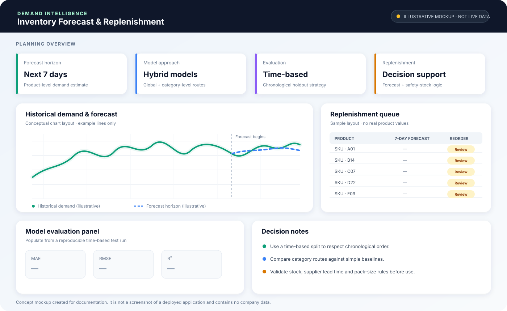

# FMCG Demand Forecasting & Inventory Replenishment

> A time-aware machine-learning workflow for forecasting product demand over the next seven days and generating preliminary replenishment recommendations from historical sales patterns.


## Project at a glance

This project explores how historical FMCG sales can support short-term product-demand planning. The workflow covers data quality checks, exploratory analysis, product-level time-series feature engineering, chronological model evaluation, and preliminary reorder recommendations.

- **Forecast target:** total units sold over the following 7 days.
- **Granularity:** product and date, with category-level context.
- **Feature engineering:** lagged sales, rolling statistics, recency, historical sales gaps, price, promotions, and calendar features.
- **Model strategy:** a global XGBoost model plus category-level CatBoost approaches and fallback logic for sparse or low-variation categories.
- **Evaluation:** MAE, RMSE, and R² on a chronological holdout; model results should be regenerated on the authorized dataset before quoting them.
- **Decision support:** forecasted demand is combined with a preliminary safety-stock estimate to produce a reorder suggestion.

> **Data note:** Real historical sales data was used during development, but the raw dataset is not included in this public repository. The data was available in an internship context and may be subject to company restrictions. Company identifiers, internal records, and business-specific outputs should only be published with explicit approval.

## Visual overview

### Forecasting workflow


### Replenishment dashboard concept



*The dashboard image is a documentation mockup, not a screenshot of a deployed application. It contains no company data or real prediction values.*

## Methodology

1. **Data validation and EDA** — inspect schema, missing values, duplicates, sales distributions, outliers, category patterns, and daily/monthly trends.
2. **Daily product panel** — aggregate sales by product and date, then represent missing product-date combinations explicitly.
3. **Time-series feature engineering** — create lag features (1, 7, 14, 28, 56, and 365 days), rolling means/medians/sums, sales variability, recent-sales indicators, recency, price, promotion, and calendar features.
4. **Forecast target** — calculate future seven-day sales for each product-date observation.
5. **Time-aware validation** — split chronologically and leave a seven-day gap around the split to reduce overlap between training labels and the test period.
6. **Model routing** — use a global XGBoost model for sparse categories; evaluate category-specific CatBoost, log-target CatBoost, and simple fallback strategies where applicable.
7. **Evaluation and replenishment** — compare predictions with held-out demand using MAE, RMSE, and R², then create a preliminary reorder recommendation.

## Repository structure

```text
fmcg-demand-forecasting-replenishment/
├── assets/
│   ├── forecasting-workflow.svg
│   └── replenishment-dashboard-mockup.svg
├── notebooks/
│   └── demand_forecasting.ipynb
├── .gitignore
├── requirements.txt
└── README.md
```

## Run locally

### 1. Clone the repository

```bash
git clone https://github.com/Corvus06655/inventory-demand-forecasting.git
cd inventory-demand-forecasting
```

### 2. Create a virtual environment

**Windows**
```bash
python -m venv .venv
.venv\\Scripts\\activate
```

**macOS/Linux**
```bash
python3 -m venv .venv
source .venv/bin/activate
```

### 3. Install dependencies

```bash
pip install -r requirements.txt
```

### 4. Add the authorized dataset

Place your permitted `historical_data.csv` file in the repository root. The notebook expects these columns:

| Column | Meaning |
|---|---|
| `product_id` | Product identifier |
| `category` | Product category |
| `hcode` | Product/commodity code |
| `sold` | Units sold |
| `date` | Sales date |
| `price` | Product price |
| `is_promotion` | Promotion indicator |

The dataset is deliberately not committed. Do not copy company data into a public repository unless your supervisor or data owner has explicitly authorized it.

### 5. Run the notebook

```bash
jupyter lab
```

Open `notebooks/demand_forecasting.ipynb` and run cells in order. Model metrics and reorder recommendations are generated by the notebook; regenerate them on the approved dataset rather than relying on stale or copied outputs.

## Important limitations

- This is an analytical prototype, not a production inventory system.
- Current on-hand stock and inventory already on order are not available as model inputs, so a reorder recommendation is not the same as a verified purchase quantity.
- The notebook's historical sales-gap feature is a proxy derived from sales events; it is **not** a verified supplier delivery lead time.
- A robust operational policy would also need supplier lead times, service-level targets, minimum order quantities, pack sizes, shelf life, and stockout/censored-demand handling.
- Performance can vary substantially by product and category. Compare each approach against a sensible baseline and review errors before operational use.
- No claims are made about realized cost savings, stockout reduction, or production deployment.

## Tech stack

**Python · Pandas · NumPy · Matplotlib · scikit-learn · XGBoost · CatBoost · Jupyter**

## Resume-ready description

**FMCG Demand Forecasting & Inventory Replenishment** — Python, Pandas, scikit-learn, XGBoost, CatBoost

- Built a product-level demand forecasting workflow using historical sales, lagged demand, rolling statistics, price, promotion, and calendar features to estimate next-seven-day sales.
- Implemented chronological evaluation and category-aware model routing with XGBoost, CatBoost, and fallback baselines; assessed performance using MAE, RMSE, and R².
- Translated forecasts into preliminary reorder suggestions using a safety-stock estimate, while documenting data limitations and avoiding unsupported claims of business impact.

*Use the resume bullets only if you can explain the implementation and have permission to describe the internship work publicly.*
